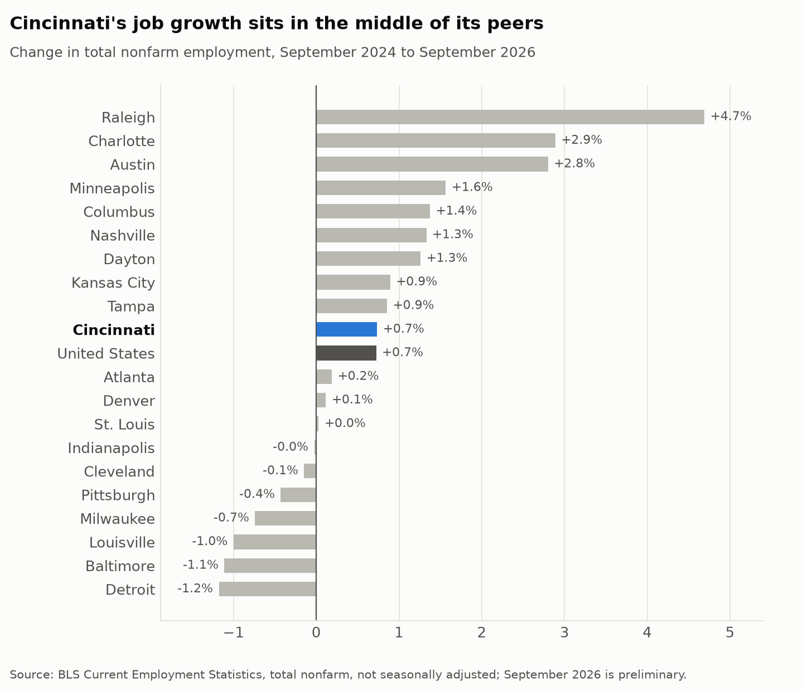
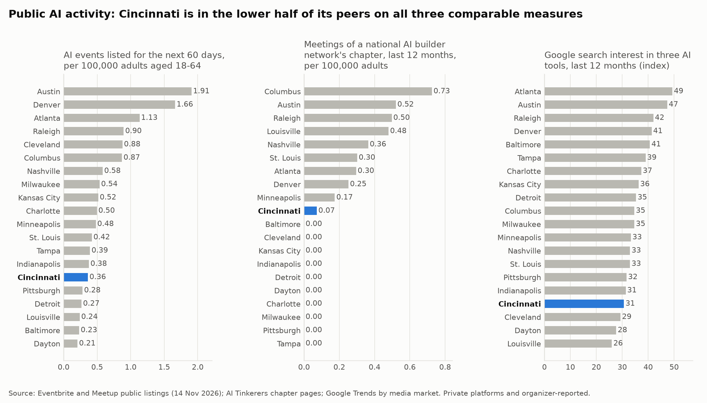
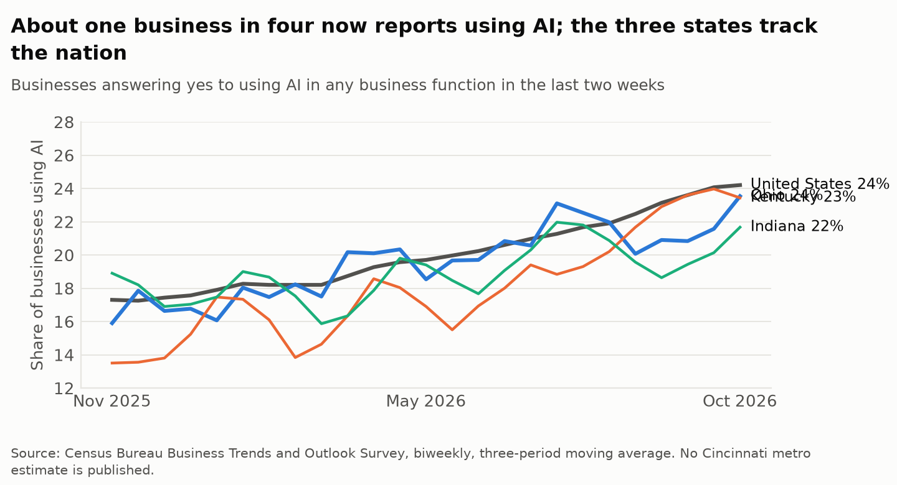
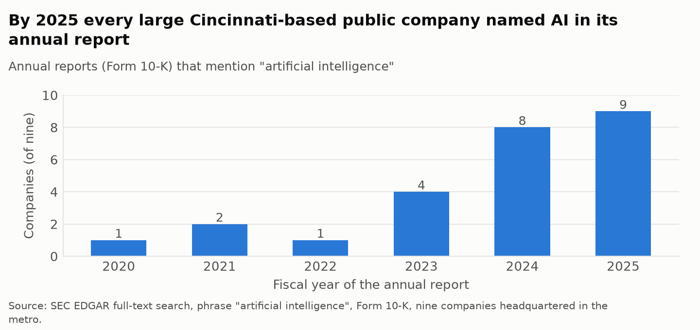
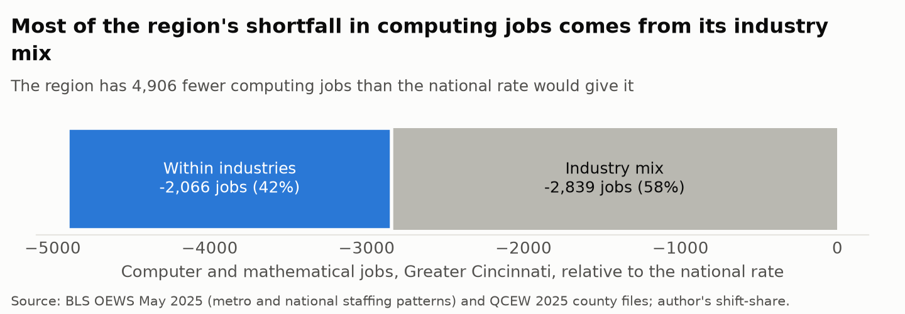
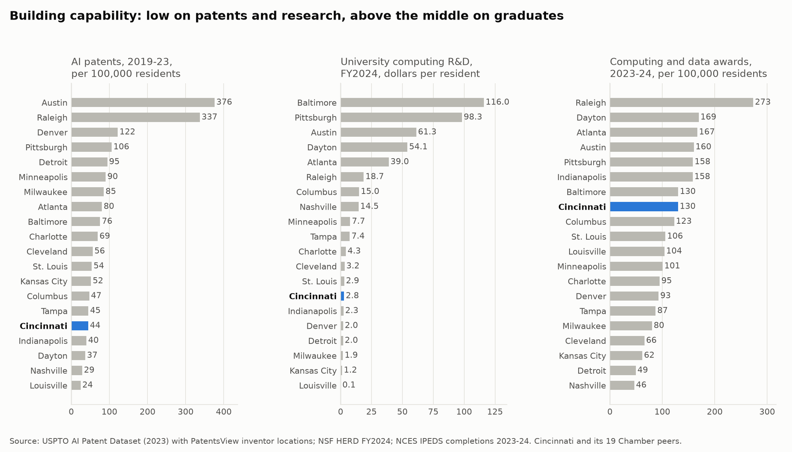
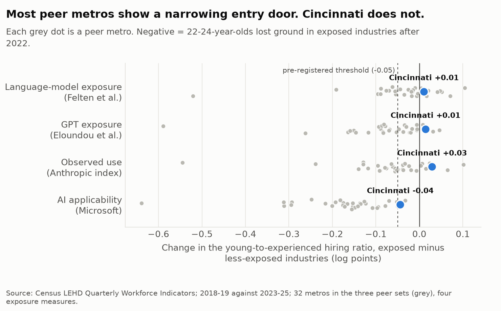
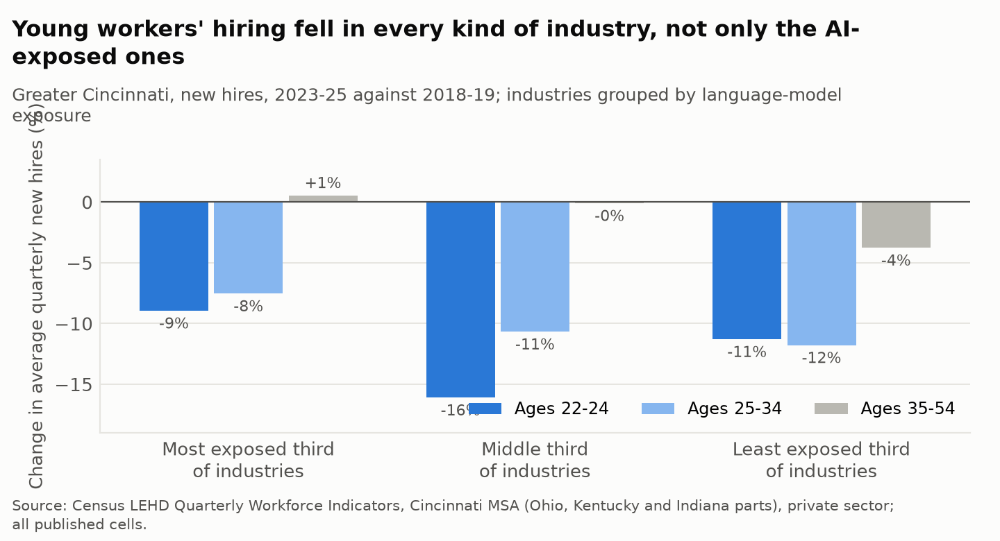
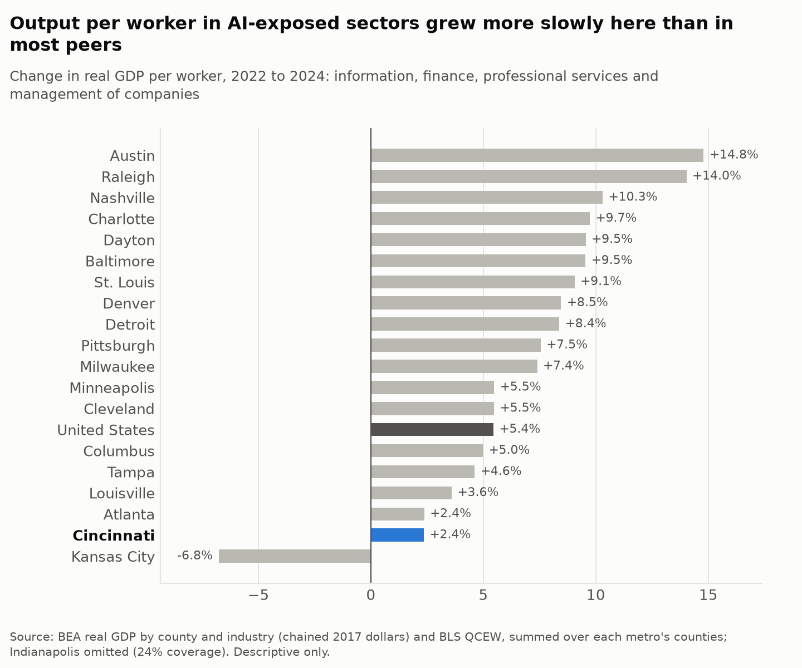
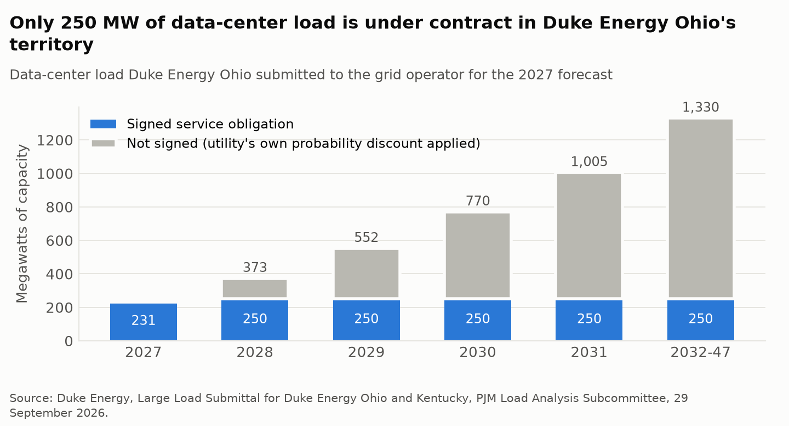

# Cincinnati AI Labor Market 2.1: Early Evidence on Awareness, Adoption, Hiring and Investment in Greater Cincinnati

**[KetiB, AFFILIATION]** · Published 17 November 2026

*An independent study. It follows the format of a metropolitan policy report and has no
affiliation with any research institution. Version 2.0 was an unpublished design stage; this
report supersedes version 1.0 (November 2026).*

---

## Corrections to version 1.0

Version 2.1 re-tested 1.0's claims against peer metros. These statements in 1.0 are corrected
or withdrawn. Each is logged with its evidence in `AUDIT.md`.

| 1.0 said | 2.1 finds |
|---|---|
| "The real fragility is slow growth": jobs grew only 0.7% in two years | Growth of 0.7% matches the nation (0.7%) and ranks 10th of 20 against the Chamber's own peers, whose median was 0.2%. **Withdrawn.** |
| 98% of projected openings are replacements, "the most consequential number in this study" | Replacement makes up 96% to 101% of projected openings in every area checked, including the nation. Cincinnati's growth share (2.0%) is higher than six of the other seven Ohio metros'. **It is a feature of the projection method, not a regional weakness.** |
| The labor force shrank by about 9,400 | Census survey data show the labor force *rising* through 2025. The monthly series' fall is entirely between September 2025 and September 2026, in model-based figures due for revision in March 2027. **Not established.** |
| The region "buys AI capability rather than building it" | 58% of the shortfall in computing jobs comes from the region's industry mix. **Restated** (section 7). |
| Exposure rises with pay, "inverting the older automation story" | True in all 33 metros examined and nationally. Cincinnati's gradient is flatter than most peers'. **A national pattern, not a local finding.** |
| Language-model exposure 0.088 (nation 0.093) | 0.079 (nation 0.095) once occupation codes are matched with the official crosswalk, which raises coverage from 80% to 97%. The conclusion, average exposure, stands. |
| 565 MW of capacity in 19 facilities | The Chamber's figure counts 17 existing and 2 *planned* facilities, the two planned ones being the largest. It mixes operating and announced capacity. |
| Neither the AI task force nor a training lab appears in the City budget | The approved budget includes a $50,000 AI line and a $300,000 AI capital item. |
| Fifth Third "has announced no reductions at all" | Merger-related layoffs followed its February 2026 acquisition of Comerica. None is attributed to AI, and none reported is in Cincinnati. |
| Kroger's cuts attributed to AI: "Partly" | Coded by one rule: *technology named, AI not named*. |

---

## Key findings

1. **Greater Cincinnati shows no narrowing of the entry door to AI-exposed work. Most of its
   peers do.** After 2022, the share of new hires going to 22-to-24-year-olds in AI-exposed
   industries moved by between −0.04 and +0.03 log points relative to less-exposed industries,
   inside the range chance alone produces. Across 31 peer metros the typical change was
   negative on all four exposure measures.

2. **Young workers' hiring did fall here, across the board.** New hires of 22-to-24-year-olds
   fell 9% in the most exposed third of industries, 16% in the middle third and 11% in the
   least exposed third. The fall is real. It is not concentrated where AI is.

3. **The region's public AI community is steady and broad, and smaller than its peers'.** The
   main community group held 35 of 36 scheduled monthly meetings in three years and reports
   more than 2,000 members. On three measures that can be compared across metros, Cincinnati
   ranks 15th, 10th and 17th of 20.

4. **Firms here use AI assistants widely. AI agents are mostly announced, not running.** Eight
   of the region's large employers have an assistant or other AI system in production on the
   record. One local firm, a vendor, documents agents in production. The claim that agents are
   at work in the region's large employers does not meet this study's evidence rule.

5. **AI adoption in the three states tracks the nation.** About 22% of Ohio businesses, 23% of
   Kentucky's and 20% of Indiana's report using AI, against 24% nationally. No estimate exists
   for the Cincinnati metro.

6. **The region's shortfall in computing jobs is mostly industry mix.** Greater Cincinnati has
   about 4,900 fewer computing jobs than the national rate would give it. About 2,800 of that
   gap comes from which industries are here.

7. **Capability is uneven: low on patents and research, above the middle on graduates.** The
   region ranks 16th of 20 on AI patents per resident, 14th on university computing research
   and 8th on computing and data degrees.

8. **Data centers remain a small jobs story.** Employment in the data-center industry rose by
   401 in the six counties with published figures between 2022 and 2025. The one large project
   with a public commitment promises 120 jobs for 250 megawatts. Only 250 MW of data-center
   load is under contract in Duke Energy Ohio's territory.

9. **Job growth is ordinary, not slow.** Employment rose 0.7% in two years, the national rate,
   and above the median of the Chamber's 19 peers.

---

## 1. Introduction

### The question

Is artificial intelligence changing who gets hired, into what work, in Greater Cincinnati, and
how far have the region's people and firms begun to take it up?

Version 1.0 could not answer the first half. It measured employment levels and compared the
region only with the nation, so it had no test that could have detected an effect. Version 2.1
is built on comparisons: AI-exposed industries against less-exposed ones, early-career workers
against experienced ones, the years before late 2022 against the years after, and Cincinnati
against other metros. The tests and their pass marks were written down before the data were
examined (`PREREGISTRATION.md`).

### Three kinds of evidence

The study rests on three kinds of evidence:

- **Infrastructure**: data centers, and the power, money and policy around them.
- **Employment signals**: hiring, occupations, wages, output and what employers say.
- **People and firms taking AI up**: public events and communities, and companies putting AI
  into their work.

### How to read this report

**Four things are kept apart**, because most writing on AI and jobs blurs them:

| Term | Meaning | Example |
|---|---|---|
| Awareness and participation | People convening around AI | A monthly meetup |
| Potential exposure | How much of a job's tasks AI could do | An exposure score for accountants |
| Observed use | AI actually being used | A business survey; a company's filing |
| Attributed displacement | An employer's own words about its own job cuts | A layoff memo that names AI |

**Geography.** "Greater Cincinnati" means the 15-county Cincinnati, OH-KY-IN metropolitan
area throughout. Sources that cover a different area are labeled every time.

**Peers.** The primary comparison is the 19 metros the Cincinnati Regional Chamber uses in its
*State of the Region 2026*. Two further sets, one chosen by population and one by industry
structure, were fixed by rule in advance and are used to check the central result.

**Source types.** Each source is labeled: government, academic, industry or advocacy,
journalism, private platform, or organizer-reported.

### How this study is checked

Every number in this report is produced by a script in the repository and covered by a
regression test: 24 checks for 2.1, alongside the 16 for 1.0. Where the analysis departed from
the pre-registered plan, the departure is listed with its reason; there are 21. Four planned
pieces were not completed and are named in section 15.

---

## 2. What the research says

Three bodies of work frame the tests.

**Exposure.** Felten, Raj and Seamans score each occupation by how much its abilities overlap
with what language models do. Eloundou, Manning, Mishkin and Rock rate tasks by whether a
language model could halve the time they take. Both measure what AI *could* touch. Two newer
measures record what it *is* used for: Anthropic's Economic Index and Microsoft Research's
applicability score (Tomlinson, Jaffe, Wang, Counts and Suri), built from records of real
conversations with AI systems. This study runs every test on all four.

**Early-career workers.** Brynjolfsson, Chandar and Chen ("Canaries in the Coal Mine?",
Stanford Digital Economy Lab, 2025) use payroll records and report that employment of workers
aged 22 to 25 fell in the most exposed occupations after late 2022, relative to older workers
and less-exposed occupations. The design here follows theirs as far as public data allow.

**Skeptics.** Acemoglu ("The Simple Macroeconomics of AI", 2024) estimates that AI will raise
productivity only modestly over a decade. Autor ("Applying AI to Rebuild Middle Class Jobs",
2024) argues that AI could restore middle-skill work if it is used to extend workers'
expertise, and treats that as a possibility that depends on choices, not a forecast.

**Data centers.** Three 2026 studies of data centers and local jobs reach compatible
conclusions. Bahar and Wright (Brookings) find about 100 to 200 jobs in a typical county that
gains a large facility. Buechler, Rolheiser and co-authors find about 2.7 local non-construction
jobs per megawatt of eventual capacity, counting all jobs in the county, not on-site staff.
Alvarez, Argente, Chow and Van Patten (NBER) find positive effects on county employment,
strongest for construction. All three cover facilities that mostly predate the AI build-out.

---

## 3. The regional economy in comparison

**Job growth is in the middle of the pack.** Total employment rose by 8,600, or 0.7%, between
September 2024 and September 2026. The nation grew 0.7%. Among the Chamber's 19 peers the
median was 0.2%, and seven lost jobs. Cincinnati ranks 10th of 20. The pre-registered rule
called growth "slow" only if the region fell in the bottom quarter. It does not.

**The "98% replacement" figure describes the method.** Ohio's projections for the Ohio part of
the metro put 2.0% of annual openings down to growth and 98.0% to replacing workers who leave
or change occupation. The same calculation gives 96.6% replacement nationally, 99.1% for Ohio,
and between 96.3% and 101.3% for the seven other Ohio metros. Only Columbus has a higher
growth share than Cincinnati. Version 1.0 treated its own projection as a finding while
dismissing the Chamber's modeled jobs figure as model output. Both are model output, and this
report labels them so.

**The labor force.** The monthly series shows the labor force 9,400 lower in September 2026
than two years earlier. All of that fall comes after September 2025. The Census Bureau's
annual survey, which ends in 2025, shows the opposite for the period it covers: a labor force
of 1,215,870 in 2024 and 1,235,990 in 2025. Splitting that change into its parts, population
growth added about 10,400 workers, an older age mix subtracted about 4,300, and higher
participation added about 17,300. Ageing is a steady drag of roughly 4,000 workers a year.
Whether the labor force then fell in 2026 cannot be confirmed until the monthly series is
revised in March 2027 and the 2026 survey is published.

---

## 4. Exposure: average, and a national pattern

Greater Cincinnati's exposure to AI is average. On each of the four measures the region's
employment-weighted score sits just below the nation's, and on three of the four it falls
inside the middle half of the Chamber's peers. On the fourth, observed use, it falls just
below. The share of jobs above a high-exposure line is close to the nation's wherever the line is
drawn on the observed-use scale: 18.3% against 18.7% at 0.30, 10.0% against 10.3% at 0.40, and
4.5% against 4.1% at 0.50.

| Measure | Cincinnati | United States | Rank among 20 (1 = most exposed) |
|---|---|---|---|
| Language-model exposure (Felten et al.) | 0.079 | 0.095 | 14 |
| GPT exposure (Eloundou et al.) | 0.306 | 0.309 | 15 |
| Observed use (Anthropic) | 0.127 | 0.131 | 16 |
| AI applicability (Microsoft) | 0.171 | 0.172 | 12 |

*Source: BLS OEWS May 2025; exposure measures as cited. Government and academic data.*

**Exposure rises with pay everywhere.** The best-paid fifth of jobs is more exposed than the
worst-paid fifth in every one of the 33 metros examined and in the nation. Cincinnati's
gradient (1.03) is smaller than the nation's (1.20) and smaller than most peers'. This is a
feature of the technology, not of the region.

---

## 5. Are people showing up? AI awareness and participation

No survey measures how many people in Greater Cincinnati use or understand AI. What can be
observed is whether people organize around it and turn up. This section measures that. It
measures convening, not use: a person can attend ten events and never use AI at work.

### What the region has

**A monthly community that has not missed a beat.** CincyAI for Humans has met monthly since
October 2023. In the three years to mid-November 2026 it scheduled 36 meetings and held 35;
one was cancelled for snow. Its newsletter archive, with a dated issue around every meeting,
is the record behind that count.

**Stated membership has grown.** The group reported "over 1,700 members" in October 2025 and
said it had "surpassed 2k members" in March 2026. Membership is a free newsletter sign-up, the
figures are the organizer's own, and they are not audited. The organizers reported "over 200
attendees" at the June 2026 meeting, which they called their largest.

**An annual event and a smaller builders' group.** Cincy AI Week has run each June since 2024.
Attendance figures in circulation for it conflict, none could be traced to a primary record in
this round, and none is used here. A local chapter of the AI Tinkerers builders' network held
five events between October 2024 and February 2026, and one in the last twelve months.

| | Dec 2023–Nov 2024 | Dec 2024–Nov 2025 | Dec 2025–14 Nov 2026 |
|---|---|---|---|
| Events held, all organizers found | 16 | 16 | 18 |
| Organizers with at least one event | 4 | 3 | 7 |
| CincyAI for Humans meetings held | 12 | 12 | 11 |

*Source: event census built from dated newsletter issues, chapter pages and event listings
(`data/ai_events.csv`). Organizer-reported and private-platform sources. The census is most
complete for recurring series and certainly misses one-off events.*

**It reaches beyond technologists.** Of 18 events held in the last twelve months, 17 were
aimed at a general, business or public audience and one at a technical audience. That passes
the pre-registered test of breadth.

### How the region compares

A count for one metro means little, because AI events rose everywhere. Three measures exist in
the same form in every metro. On all three, Cincinnati is in the lower half of the Chamber's
peers. By the pre-registered rule it is **within the normal range of its peers**: inside the
middle half on two measures and just below it on the third.

| Measure | Cincinnati | Peer median | Rank of 20 |
|---|---|---|---|
| AI events listed for the next 60 days, per 100,000 adults | 0.36 | 0.50 | 15 |
| Chapter meetings of a national builders' network, last 12 months, per 100,000 adults | 0.07 | 0.00 | 10 |
| Search interest in three AI tools (index) | 31 | 35 | 17 |

Two cautions apply. The chapter measure counts one national organization, and Cincinnati's
main community is home-grown, so that measure understates it. Counting CincyAI's 11 meetings
would put the region first, though other metros' home-grown groups are not counted either. And the search measure rests on three terms, not the seven
planned, because the service stopped supplying the data.

### Does awareness mean anything?

Awareness is worth calling an early indicator only if it relates to something later.

**Across metros, there is a tentative link.** Metros with more listed AI events also have more
job postings that name AI tools (rank correlation 0.54), and so do metros with more chapter
meetings (0.41). That meets the pre-registered rule. It should be read as suggestive: the
result does not hold when postings are measured by a third phrase, and twenty metros is a
small sample.

**Over time, the question could not be tested.** No public monthly series of AI job postings
exists for the metro, so this study cannot say whether community activity came before, with or
after firms' hiring. Calling awareness an early indicator describes a plausible sequence. It
is not a finding here.

**Whether employers are in the room was not measured.** That needs the host and sponsors of
every event recorded, which this round did not do.

---

## 6. Adoption: are local firms using AI?

### What the surveys say

**About one business in four reports using AI.** In the Census Bureau's business survey, 23.7%
of US businesses said in autumn 2026 that they had used AI in the previous two weeks, up from
17.8% in late 2025, when the current question was introduced. Ohio stood at 22.2%, Kentucky at 23.2% and Indiana at 20.2%. Ohio ranks
27th of 53 states and territories. The survey publishes metro estimates only for the 25
largest metros, and Cincinnati is not one of them. **No Cincinnati figure exists, and none is
reported here.**

**Use by individuals is below the national rate.** Anthropic's index of its own product's use
puts Ohio at 0.59 and Indiana at 0.61 of the national per-person rate, and Kentucky at 0.39
(April–May 2026). This is one company's product and a state-level figure.

### What the region's companies say

**AI moved into every large company's annual report in two years.** Of nine public companies
headquartered in the metro, one or two mentioned "artificial intelligence" in their annual
reports for 2020 to 2022. Four did for 2023, eight for 2024 and all nine for 2025.

### Agents at work

An **AI agent**, in this report, is a system that carries out a task of several steps by
itself, using other software, with a person reviewing the result at most. An **assistant**
drafts or suggests while a person carries out each step. Companies use "agent" loosely, so
each case below is classified by what the source describes. Only a company's own record, or a
named executive on the record, counts as evidence.

| What the record shows | Employers |
|---|---|
| An assistant or other AI system in production | Kroger, Procter & Gamble, Fifth Third, Cincinnati Financial, University of Cincinnati, TriHealth, The Christ Hospital, Bon Secours Mercy Health |
| An agent in development or announced | Kroger |
| An agent in production | CBTS (a Cincinnati technology vendor that sells agents) |
| Reported but not verified in this round | Fifth Third, GE Aerospace, Cincinnati Children's, Bon Secours Mercy Health, Cintas |
| No statement found | UC Health, St. Elizabeth Healthcare, Hamilton County, Miami University, American Financial Group, Western & Southern, E.W. Scripps, DHL, U.S. Bank, CVG Airport |

*Source: `data/ai_agent_register.csv`, 19 entries, each with its source and grade. Company
records, and journalism quoting named executives.*

**Assistants are in production and at scale.** Fifth Third's annual report says about 30% of
its new code was AI-generated in the last quarter of 2025 and that 56% of its staff use AI
tools daily. A Kroger executive said its staff assistant "is actively used by up to 150,000
associates". Procter & Gamble says it has trained more than 20,000 employees on its internal
tools. The University of Cincinnati opened its AI platform to all staff in December 2025 and
all students in February 2026.

**Agents are mostly a plan.** Kroger says it "is also working on improving agents for
frontline teams". Fifth Third's annual report describes agentic workflows as planned.
TriHealth's chief executive places agents about five years out. The one documented case of
agents in production is CBTS, which says it "now runs internal agents across customer
experience, finance, operations, and workforce functions"; CBTS also sells the product, so
this is a vendor's account of itself.

The pre-registered rule allowed the sentence "AI agents are in production at large Greater
Cincinnati employers" only with verified evidence from three employers. There is one. The
sentence is not used.

**What companies say about jobs.** Five of the thirteen verified records include a statement
about work. Kroger: "the human connection to a customer or fellow associate will never be
replaced by AI." TriHealth: "The idea isn't to remove people from healthcare." Fifth Third has
attributed no reductions to AI. No verified record attributes a job cut to an AI agent.

**Silence is common and is not evidence of no use.** Ten of the region's large employers have
no statement that this round could find.

### Postings that name AI tools

Greater Cincinnati has 7.8 job postings per 100,000 adults naming "AI agent" or "large
language model", against a peer median of 8.3. It ranks 13th of 20.

---

## 7. Capability: building or buying?

Version 1.0 said the region buys AI capability rather than building it, pointing to a low
share of computing jobs. That share can be low for two different reasons: the region may have
fewer of the industries that employ computing workers, or its industries may each employ
fewer of them than the same industries do elsewhere. Only the second says something about
building.

**The gap is mostly industry mix.** Computing occupations are 2.94% of the region's jobs
against 3.38% nationally, a shortfall of about 4,900 jobs. If every local industry employed
computing workers at its national rate, the region would still be about 2,800 short. The
remaining 2,100, or 42% of the gap, is within industries.

The pre-registered rule kept "buying rather than building" only if the within-industry part
was at least half. It is not. The claim is restated: **the region's industry mix employs
fewer computing workers, and its industries employ somewhat fewer than the same industries do
nationally.**

**The capability measures are mixed.**

| Measure | Cincinnati | Peer median | Rank of 20 |
|---|---|---|---|
| AI patents, 2019–23, per 100,000 residents | 44 | 69 | 16 |
| University computing research, FY2024, per resident | $2.80 | $7.41 | 14 |
| Computing and data degrees and certificates, 2023–24, per 100,000 residents | 130 | 104 | 8 |

The region's universities spent $772 million on research in fiscal 2024, of which $6.5 million
was in computer and information sciences. The University of Cincinnati accounts for more than
half of the region's computing awards. The region trains computing graduates at an
above-median rate and produces AI research and patents at a below-median one.

---

## 8. Hiring and the entry door

This is the study's central test. Version 1.0 argued that AI's main risk here was fewer
entry-level hires in exposed professional work, and said the risk was hard to see in job
counts. Census hiring records make it visible.

### The test

For each metro, the test compares new hires of 22-to-24-year-olds with new hires of
35-to-54-year-olds, in the most AI-exposed third of industries against the least exposed
third, in 2023–2025 against 2018–2019. A negative result means young workers lost ground in
exposed industries specifically. Industries are classified from national 2022 staffing
patterns, fixed before generative AI arrived.

A narrowing entry door required three things together: a fall of at least 0.05 log points
(about 5%), a result outside the range that random groupings of industries produce, and the
same direction on at least two exposure measures.

### The result for Greater Cincinnati

**None of the three conditions is met.**

| Exposure measure | Cincinnati | Range chance produces | Median of Chamber peers | Cincinnati's rank from the bottom, of 19 |
|---|---|---|---|---|
| Language-model exposure | +0.010 | −0.115 to +0.129 | −0.022 | 14 |
| GPT exposure | +0.014 | −0.109 to +0.117 | −0.077 | 18 |
| Observed use | +0.029 | −0.113 to +0.119 | −0.056 | 18 |
| AI applicability | −0.044 | −0.115 to +0.114 | −0.161 | 19 |

*Source: Census LEHD Quarterly Workforce Indicators, private sector, 2018Q1–2025Q4. The series
kept cover 97% to 99% of employment in each group. Government data.*

### The result for the peers

**Most peers show the pattern Cincinnati lacks.** Across 31 other metros, the change was
negative in 68% to 100% of them depending on the measure, and at or beyond the 0.05 threshold
in about half on two measures and in all but one on a third. Cincinnati sits at or near the
favorable end on every measure. A second test, using Census survey data on occupations, points
the same way for the peers as a group: pooled across the 20 metros, employment of
22-to-25-year-olds in the most exposed occupations fell by 8% to 13% relative to older
workers and less-exposed occupations, a statistically clear result. Cincinnati's own estimate
from that survey is too imprecise to read (plus or minus about 0.25).

### What is happening to young workers here

**Their hiring fell everywhere, not where AI is.**

New hires of 22-to-24-year-olds fell 9% in the most exposed industries. They fell 16% in the
middle group and 11% in the least exposed. Hires of 35-to-54-year-olds were flat or slightly
down. The entry door did narrow in Greater Cincinnati. It narrowed for young workers in
general, which points to causes that act across the whole economy: a slower hiring market,
fewer young people, or employers' caution, not AI's reach into particular work.

### Checks

**Interest rates.** The 2022–23 rate rises hit finance and technology, the most exposed
industries, as generative AI arrived. With information, finance and real estate removed, the
result is unchanged (+0.02 to +0.05; −0.03 on the fourth measure). Rate-sensitive industries
with little exposure, construction and durable manufacturing, show no young-worker decline
relative to the comparison group.

**Timing.** The gap for exposed industries was at its lowest in 2021–2022, before generative
AI, and had turned positive on three measures by 2025.

**Headcount.** Measured by employment instead of hires, the result is more negative (−0.01 to
−0.12) and on the Microsoft measure it crosses both thresholds. On the primary measure and two
others it does not. This is the one place the evidence leans the other way, and it is reported
as mixed.

**Pay.** New hires' earnings moved the same way for young and older workers in exposed
industries. A fall in demand for young workers would show in pay as well as numbers. It does
not.

### Two employers, two paths

Kroger announced about 3,000 corporate job cuts in October 2026. Its memo, as reported, says
technology "is reshaping what's possible" and does not name AI. Earlier that year a Kroger
executive said its staff AI assistant was in use by up to 150,000 associates. Fifth Third reports that nearly a third of
its new code is AI-generated and has attributed no job cut to AI; its chief executive has said
clients tell him AI is not what is driving their productivity gains. Two of the region's
largest employers use AI heavily. One is cutting corporate jobs and one is not, and neither
says AI is the reason. Procter & Gamble's larger reduction, of up to 7,000 roles, was
attributed to costs, tariffs and consumer uncertainty.

Coded by one rule, applied to each: Kroger, *technology named, AI not named*; Procter &
Gamble, *neither*; Fifth Third, *neither* (merger).

---

## 9. Output per worker

*Descriptive only. Two years of data cannot attribute anything to AI.*

Real output per worker in the four most exposed sectors (information, finance, professional
services and management of companies) rose 2.4% in Greater Cincinnati between 2022 and 2024.
The national figure was 5.4% and the peer median 7.5%. In the rest of the private economy,
output per worker rose 1.9% here and 2.5% nationally.

If AI were lifting productivity in exposed sectors, this is where it would show first. In
Greater Cincinnati it has not shown yet. Output per worker in finance fell here in 2024.

---

## 10. Data centers and AI infrastructure

Version 1.0 said data centers are not a jobs story. The pre-registration set three ways that
finding could be overturned. None is met.

### Facilities and capacity

| Status | What the record shows | Source type |
|---|---|---|
| Operating | 17 facilities in the region. The Chamber says each "likely employs two to ten full-time workers" | Advocacy, on private data |
| Under construction | Prologis campus in Trenton, Butler County: reported as 250 MW, four buildings, about 140 acres | Journalism |
| Under contract with the utility | 231 MW in 2027 and 250 MW from 2028 in Duke Energy Ohio's territory | Utility filing to the grid operator |
| Not under contract | A further 1,080 MW by the 2030s, after the utility's own discount for projects that may not proceed | Utility filing to the grid operator |

The Chamber's figure of 565 MW adds 17 existing facilities to 2 planned ones and does not say
what kind of megawatts it counts. It should not be read as operating capacity. Duke Energy's
filing of 29 September 2026, its first for data centers in Ohio, is the firmest number
available: 250 MW committed. For scale, the Chamber puts the Columbus region at more than
3,150 MW.

### Jobs

**Test 1: at least 0.5 permanent jobs per MW at three facilities. Not met.** One regional
facility has a public commitment: Prologis estimates 120 full-time jobs by 2035 for its
250 MW campus, or 0.48 per MW. That is three times the Chamber's planning assumption of 0.15
and still below the threshold, and it is one facility. Around Columbus, Microsoft says each of
its buildings will employ about 50 people. Across Ohio's tax-exemption agreements, facilities
other than Amazon's pledged about 30 jobs each.

**Test 2: at least 1,000 more jobs in the data-center industry. Not met.** In the six metro
counties with published figures, employment in data processing and hosting rose from 1,576 in
2022 to 1,977 in 2025, a gain of 401. Warren County more than doubled, from 230 to 511. Butler
County, where the largest project is being built, is withheld in every year from 2022, so the
test cannot see it. The Columbus region gained 1,220 over the same period.

**Test 3: at least 1,100 permanent jobs committed in signed agreements. Not met.** The
Trenton commitment is 120.

**Construction.** No primary record found puts more than 1,000 construction workers on
regional data-center projects at one time.

The research cited in section 2 would lead one to expect a few hundred additional jobs in a
county that gains a large facility, most of them outside the building. That is consistent
with what the region's records show. **Version 1.0's finding stands: data centers bring
investment and tax base, and few permanent jobs.**

### Public money and policy

- Trenton granted Prologis a 75% property-tax abatement for 15 years on each new building.
  Payroll in the agreement was raised from $5 million to $9 million after residents objected.
- Ohio has committed at least $2.3 billion in sales-tax exemptions to data centers statewide.
  New exemptions were paused in May 2026.
- A bill to study and regulate data centers passed the Ohio House 93–0. A Senate substitute
  that would halve the sales-tax exemption was still pending in June 2026; its status since
  was not confirmed.
- Trenton residents petitioned to bar data centers above 25 MW. Warren County imposed a
  moratorium, and Cincinnati extended an interim zoning control to February 2027.
- The Ohio Consumers' Counsel says data centers "create relatively few permanent jobs once
  they are built" and can put upward pressure on residential electricity prices. The tariff
  that makes large data centers pay for most of their contracted capacity applies in AEP
  Ohio's territory, around Columbus. No equivalent was confirmed for Duke Energy Ohio.

### The link to AI work and to the community

Data centers host AI. The records give no sign that they create AI jobs here: the roles named
are facility managers, electricians and network technicians. Whether data-center operators
take part in the region's AI community could not be answered, because event sponsors were not
recorded.

---

## 11. What the evidence can and cannot attribute to AI

| Claim | Status |
|---|---|
| AI has reduced entry-level hiring in exposed industries in Greater Cincinnati | **Not supported.** The test found no such pattern |
| AI has reduced entry-level hiring in exposed industries in peer metros | **Consistent with the evidence**, not proven. Other forces that hit young workers in those industries cannot be ruled out |
| Young workers' hiring has fallen in Greater Cincinnati | **Supported**, in every group of industries |
| AI has caused job losses in Greater Cincinnati | **No evidence.** No employer statement verified here attributes a cut to AI |
| Local firms use AI | **Supported** for named large employers and at state level. No metro rate exists |
| AI agents are doing work at the region's large employers | **Not supported** by this study's evidence rule |
| Community activity predicts firm adoption | **Tentative** across metros; **untested** over time |
| AI is raising output per worker here | **No sign yet** |
| Data centers are creating many permanent jobs here | **Not supported** |

Event activity is never evidence of a change in employment.

---

## 12. Numbers in circulation

Four figures are quoted in the region. Each needs its label.

- **"Cincinnati MSA" projections.** Ohio's projections under that name cover the Ohio counties
  only: a base of 907,000 jobs against 1.1 million in the metro.
- **3,203 jobs from data centers.** This is the Chamber's modeled total for a scenario,
  including jobs in suppliers and from workers' spending. Its own table implies about 38
  on-site jobs for a 250 MW facility. The modeled direct jobs are about 30 times that; the
  modeled total is about 85 times.
- **565 MW.** Existing and planned capacity combined (section 10).
- **A "D-minus" for the City's readiness.** This was a spoken answer to a council member's
  question at a committee meeting on 4 May 2026, given by the chair of the City's AI task
  force. It was not the result of an index or a survey. The meeting's captions are unclear at
  that moment and the recording should be checked before the grade is quoted.

---

## 13. Outlook

*This section is interpretation. It is separate from the findings above.*

### Four lenses

**Comparative advantage (Noah Smith).** Smith argues that people can keep well-paid work even
where AI is better at a task, provided something limits how much AI there is, and he stresses
that this is a possibility, not a guarantee. The region's advantages when routine office work
gets cheap are the things it already does at scale and in person: advanced manufacturing,
health care, logistics, consumer goods. Its exposed professional work is concentrated in the
headquarters of a few large companies, which is where the corporate cuts of 2025–26 have
fallen.

**The capacity to build (Ezra Klein and Derek Thompson).** *Abundance* argues that growth is
limited by the ability to build energy, housing and public capacity. The region's record here
is cautious: 250 MW contracted against thousands around Columbus, and local moratoria and
zoning controls. That caution has a cost in investment and a benefit in avoided risk to
ratepayers. Klein has also discussed AI's risks to workers and to institutions; no specific
piece was confirmed for this report, so none is cited.

**The exponential gap (Azeem Azhar).** Azhar argues that technology improves faster than
institutions adapt. The region gives one clean example: every large public company named AI in
its annual report by 2025, while the City's assessment of its own readiness in 2026 was an
impromptu letter grade. Against that, the community group has met monthly for three years and
the largest university gave every student access to AI tools in early 2026.

**The skeptics.** Acemoglu's expectation of modest gains fits the output data so far. Autor's
question, whether AI extends workers' expertise or replaces it, is the right one to ask of
each deployment in the register. The hospital systems' own language points toward extending
it. That is what companies say, and it has not been measured.

### The bull case

Greater Cincinnati has, so far, avoided the narrowing of entry-level hiring in exposed work
that most of its peers show. Its firms have adopted assistants at scale without attributing
job losses to them. It trains more computing graduates than the typical peer, and has a civic
AI community that is unusually regular and aimed at the general public. If AI complements the
work the region already does, the region is positioned to absorb it without the disruption
visible elsewhere.

### The bear case

The same evidence has a second reading. The region may show no AI effect on hiring because it
is adopting later, not better: its public AI activity, its postings naming AI tools, its
patents and its research all rank in the lower half of its peers, and output per worker in
its exposed sectors is growing more slowly. If the peers are early and Cincinnati is late,
the entry-door effect may still arrive. Young workers' hiring is already falling, whatever
the cause, and the headcount version of the test leans negative.

### Leading indicators

| Indicator | Signal for the bear case | Signal for the bull case | Next data |
|---|---|---|---|
| Hiring test (Census QWI) | Cincinnati's result falls to −0.05 or below on two measures | Stays inside the chance range through 2026 | Each quarterly release |
| Young workers' hires, all industries | Continues to fall | Recovers toward 2018–19 levels | Each quarterly release |
| Business AI use, Ohio (Census survey) | Falls further behind the nation | Closes the 1.5-point gap | Biweekly |
| Postings naming AI tools, per adult | Rank falls below 13th of 20 | Rises above the peer median | Re-run every six months |
| AI events listed, per adult | Rank stays at 15th or below | Rises above the peer median | Re-run every six months |
| Agents in production | Still one documented case in a year | Three or more large employers document one | Annual reports, early 2027 |
| Output per worker, exposed sectors | Gap with peers widens | Growth reaches the peer median | BEA, December 2026 |
| Data-center load under contract | — | Exceeds 250 MW with job commitments above 0.5 per MW | PJM forecast, January 2027 |

The monitoring sheet (`MONITORING.md`) says how to update each.

---

## 14. Policy implications

*Separate from the findings. These follow from the evidence above and are the author's
judgment.*

**For workforce boards and colleges.** The problem to solve is young workers' hiring in
general. Programs aimed only at "AI-exposed" occupations would miss most of the decline.

**For employers.** The record shows assistants in wide use and agents still planned. Decisions
about agents and entry-level roles are mostly ahead. Employers who publish what they deploy
and what it does to hiring would give the region evidence it now lacks: ten of the largest
employers have said nothing that could be found.

**For the City and county.** The readiness of public institutions has been asserted, in one
direction or the other, without measurement. The measures in this report (meeting records,
training on offer, staff access to tools) can be collected at little cost.

**For state legislators working on data-center bills.** In this region the firm number is
250 MW and the documented job commitment is 120. Job conditions tied to megawatts would bind
here: the one public commitment is 0.48 jobs per MW. Incentives should be weighed against that
scale, not against modeled totals.

**For the Chamber, CAIC and JobsOhio.** The region's gap is in research and invention more
than in training. It graduates computing students at an above-median rate and patents AI at a
below-median one. Where those graduates go to work is the next question worth answering.

---

## 15. Methods appendix

### Data vintages

| Series | Geography | Last data point | Released | Type |
|---|---|---|---|---|
| Census QWI, hires by age and industry | Metro (state parts summed) | 2025 Q4 (Kentucky's last quarter) | Aug–Nov 2026 | Government |
| ACS 1-year microdata | Metro, approximated from PUMAs | 2024 (2025 not yet released) | Dec 2025 | Government |
| ACS 1-year labor force by age | Metro | 2025 | Sept 2026 | Government |
| BLS CES total nonfarm | Metro | Sept 2026 (preliminary) | Oct 2026 | Government |
| BLS LAUS | Metro | Sept 2026 | Oct 2026 | Government |
| BLS OEWS | Metro, nation | May 2025; May 2022 staffing patterns | 2026; 2023 | Government |
| BLS QCEW | County | 2025 annual | 2026 | Government |
| BEA real GDP by county and industry | County | 2024 | Feb 2026 | Government |
| Census Business Trends and Outlook Survey | State, nation, 25 metros | Period ending 18 Oct 2026 | 5 Nov 2026 | Government |
| Anthropic Economic Index | State | April–May 2026 | 26 June 2026 | Industry |
| Ohio projections | Ohio counties of the metro | 2022–2032 | June 2025 | Government |
| BLS national projections | Nation | 2025–2035 | 2026 | Government |
| USPTO AI Patent Dataset; PatentsView | Inventor county | Patents to 2023 | 2025 (archived copies) | Government |
| NSF HERD | Institution | FY2024 (FY2025 due 24 Nov 2026) | 2025 | Government |
| IPEDS completions | Institution | 2023–24 | 2025 | Government |
| SEC filings | Company | Fiscal 2025 annual reports | Read 14 Nov 2026 | Government |
| Duke Energy large-load submittal | Utility zone | Filed 29 Sept 2026 | — | Utility filing |
| Event listings; chapter pages; search interest | Metro | Collected 14 Nov 2026 | — | Private platform; organizer-reported |
| Job postings naming AI tools | 25 miles of each city | Collected 14 Nov 2026 | — | Government (National Labor Exchange) |
| Event census; agent register | Greater Cincinnati | Collected 14 Nov 2026 | — | Organizer-reported; company records; journalism |

Nothing is extrapolated past its last data point.

### The hiring test

Industries are the 84 private three-digit industries in the Census hiring data. Each
industry's exposure is the employment-weighted average exposure of its occupations in
national May 2022 staffing patterns. "Exposed" is the top third of industries by national
employment and "less exposed" the bottom third. Young is ages 22–24; experienced is 35–54. The
statistic is the change, from 2018–19 to 2023–25, in the log ratio of young to experienced new
hires in exposed industries, minus the same change in less-exposed industries. The chance
range is the 10th to 90th percentile of 1,000 random assignments of industries to the two
groups. Cells the Census Bureau withholds are never estimated; a series is used only if it is
published in every quarter of both periods.

### What was not completed

- **Layoff notices.** State WARN lists could not be retrieved, so employer attribution rests
  on company statements alone.
- **Employers at events, and training on offer.** Not measured.
- **The full event census for six comparison metros.** Built for Cincinnati only. The peer
  comparison rests on the three like-for-like measures.
- **The participation index.** Not computed, because its components were not collected for
  peers.

### Not verified

Items listed as "reported but not verified" in section 6 come from search summaries of pages
that would not load. The Cleveland Fed's survey figures and the OhioX and Marketplace material
identified at the design stage were not re-read in this round and are not used for any number
in this report. The account of Ohio's data-center bill comes from search summaries of
legislative and news pages, and its status after June 2026 was not confirmed. The local zoning
and moratorium items were identified at the design stage and not re-read.

Deviations from the pre-registration are listed in full in `PREREGISTRATION.md`.

---

## 16. Sources

**Government.** US Census Bureau: Quarterly Workforce Indicators; American Community Survey
1-year summary files and microdata; Business Trends and Outlook Survey; Vintage 2025
population estimates. Bureau of Labor Statistics: Current Employment Statistics; Local Area
Unemployment Statistics; Occupational Employment and Wage Statistics; Quarterly Census of
Employment and Wages; Employment Projections 2025–2035. Bureau of Economic Analysis: GDP by
county and industry. Ohio Department of Job and Family Services: long-term projections
2022–2032. US Patent and Trademark Office: Artificial Intelligence Patent Dataset, 2023
update; PatentsView. National Science Foundation: Higher Education Research and Development
Survey, FY2024. National Center for Education Statistics: IPEDS. Securities and Exchange
Commission: EDGAR full-text search; Fifth Third Bancorp annual report for 2025. Office of the
Ohio Consumers' Counsel: "Quick Facts: Data Centers in Ohio". City of Cincinnati budget
documents.

**Utility filing.** Duke Energy, "Large Load Submittal for Duke Energy Ohio and Kentucky",
PJM Load Analysis Subcommittee, 29 September 2026.

**Academic and research.** Felten, Raj and Seamans, AI Occupational Exposure (2021, 2023).
Eloundou, Manning, Mishkin and Rock, "GPTs are GPTs" (2024). Tomlinson, Jaffe, Wang, Counts
and Suri, "Working with AI" (Microsoft Research). Brynjolfsson, Chandar and Chen, "Canaries in
the Coal Mine?" (2025). Acemoglu, "The Simple Macroeconomics of AI" (NBER 32487, 2024). Autor,
"Applying AI to Rebuild Middle Class Jobs" (NBER 32140, 2024). Bahar and Wright, "New evidence
on data center employment effects" (Brookings, 2026). Alvarez, Argente, Chow and Van Patten,
"Data Centers and Local Economies in the Age of AI" (NBER 35194, 2026). Buechler, Rolheiser
and co-authors, working paper reported in *The Conversation*, October 2026.

**Industry and advocacy.** Anthropic Economic Index. Cincinnati Regional Chamber, *State of
the Region 2026* and *Data Centers: A Cincinnati Regional Perspective* (2026). REDI
Cincinnati, largest employers. Microsoft and EY, datacenter economic impact in Licking County
(June 2026). Company press releases: Kroger (11 January and 22 September 2026); CBTS
(1 September 2026). University of Cincinnati news (December 2025; February and July 2026).

**Journalism.** WYSO/WVXU, 9 July 2026 (Trenton abatement). Signal Ohio, 9 June 2026
(sales-tax exemptions). CIO Dive, 14 January 2026 (Kroger). CDO Magazine, May 2026 (Procter &
Gamble). Coverager, 2026 (Cincinnati Financial). WKRC Local 12, 31 August 2026 (TriHealth).
*Cincinnati Enquirer*, 9 January 2024 (hospitals). Fortune and *The Conversation*, October
2026 (data-center study).

**Commentary.** Smith, "Plentiful, high-paying jobs in the age of AI" (*Noahpinion*, 2024).
Klein and Thompson, *Abundance* (2025). Azhar, *The Exponential Age* (2021).

**Private platforms and organizer-reported.** Eventbrite and Meetup public listings; Google
Trends; AI Tinkerers chapter pages; CincyAI for Humans newsletter archive.
